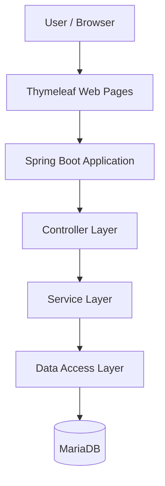
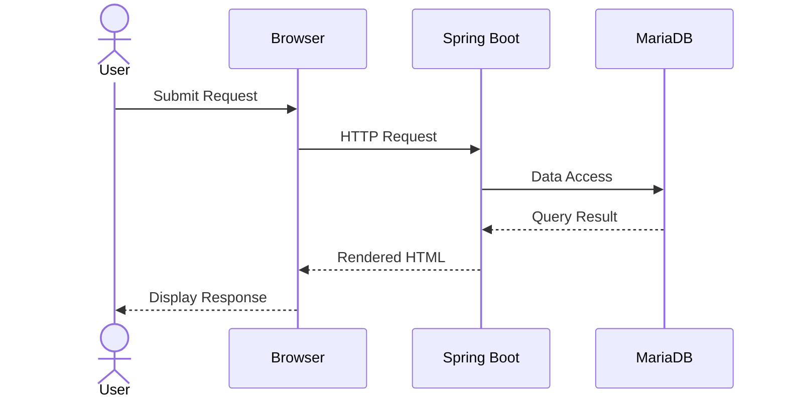

# 🛍️ Shop
### Spring Boot 기반 웹 쇼핑몰 애플리케이션

**Java 17 · Spring Boot · Thymeleaf · MariaDB**

웹 애플리케이션의 설계부터 데이터베이스 연동까지, Java와 Spring 생태계의 핵심 기술을 활용하는 쇼핑몰 프로젝트입니다.

[Repository](https://github.com/bjsealang1-spec/Shop)

---

## 📸 Project Overview

Shop은 Spring Boot 기반의 웹 애플리케이션으로, 서버 사이드 렌더링과 관계형 데이터베이스 연동을 중심으로 구성합니다.

- **Backend:** Spring Boot 기반 애플리케이션 구성
- **Frontend:** Thymeleaf 기반 서버 사이드 화면 렌더링
- **Database:** MariaDB 연동 환경
- **Data Access:** MyBatis 및 Spring Data JPA 관련 기술 구성
- **Security:** Spring Security 기반 보안 기능 구성

## 🧰 Tech Stack

| Category | Technology |
|---|---|
| Language | Java 17 |
| Framework | Spring Boot 3.5.14 |
| Build | Gradle |
| Template Engine | Thymeleaf |
| Database | MariaDB |
| Data Access | MyBatis, Spring Data JPA |
| Security | Spring Security |
| Validation | Spring Boot Validation |
| AOP | Spring AOP |
| Testing | JUnit Platform, Spring Boot Test |
| Version Control | Git, GitHub |

## 🏗️ System Architecture



> 개념적인 계층 구조입니다. 실제 패키지 및 호출 구조는 소스 코드 확인 후 업데이트해야 합니다.

## 🔄 Request Processing Flow



> 위 흐름은 일반적인 서버 사이드 웹 애플리케이션의 예시입니다. 실제 요청 처리 방식은 구현에 따라 달라질 수 있습니다.

## 🎯 Development Goals

- Spring Boot 기반 웹 애플리케이션 구조 이해
- Controller, Service, Data Access 계층의 역할 분리
- 관계형 데이터베이스 연동 및 데이터 처리
- Thymeleaf를 활용한 동적 웹 페이지 렌더링
- Spring Security를 활용한 인증·인가 구조 설계
- Validation과 테스트를 통한 애플리케이션 안정성 향상

## 💡 Technical Highlights

### 1. Spring Boot Application

Spring Boot의 자동 설정과 Gradle 의존성 관리를 활용해 애플리케이션 실행 환경을 구성합니다.

### 2. Server-Side Rendering

Thymeleaf를 활용해 서버에서 전달한 데이터를 HTML 화면에 렌더링할 수 있도록 구성합니다.

### 3. Database Integration

MariaDB JDBC 드라이버와 데이터 접근 기술을 활용해 관계형 데이터베이스와 연동할 수 있는 기반을 마련합니다.

### 4. Security & Validation

Spring Security와 Validation을 통해 접근 제어 및 입력 데이터 검증 기능을 구성할 수 있도록 합니다.

### 5. Maintainable Design

AOP와 계층 분리 원칙을 활용해 공통 관심사와 핵심 비즈니스 로직을 분리하는 방향으로 확장할 수 있습니다.

## 🚀 Getting Started

### Requirements

- JDK 17
- Git
- MariaDB
- Gradle Wrapper

### 1. Clone Repository

```bash
git clone https://github.com/bjsealang1-spec/Shop.git
cd Shop
```

### 2. Configure Database

프로젝트의 `application.yml` 또는 `application.properties` 파일을 확인하고 MariaDB 접속 정보를 설정합니다.

데이터베이스 이름, 계정 정보, 테이블 스키마는 실제 프로젝트 설정에 맞게 적용해야 합니다.

### 3. Run Application

**Windows PowerShell**

```powershell
.\gradlew.bat bootRun
```

**macOS / Linux**

```bash
./gradlew bootRun
```

> 데이터베이스 연결 설정과 초기 스키마 구성이 완료되어 있어야 정상적으로 실행할 수 있습니다.

## 🧪 Testing

프로젝트에 포함된 테스트는 다음 명령어로 실행할 수 있습니다.

**Windows PowerShell**

```powershell
.\gradlew.bat test
```

**macOS / Linux**

```bash
./gradlew test
```

## 🔐 Security Considerations

- 데이터베이스 비밀번호 및 민감한 설정을 저장소에 직접 커밋하지 않습니다.
- 개발 환경과 배포 환경의 설정을 분리합니다.
- 인증·인가 및 입력값 검증을 테스트합니다.
- 예외 처리와 로그 관리를 통해 문제를 추적할 수 있도록 개선합니다.

## 🛣️ Future Improvements

- 실제 구현된 도메인 기능 및 사용자 흐름 상세화
- 데이터베이스 스키마와 엔티티 관계 문서화
- 단위 테스트 및 통합 테스트 강화
- 예외 처리 및 오류 응답 개선
- 환경별 설정 관리 및 배포 자동화
- 실제 실행 화면 및 기능별 스크린샷 추가

## 👩‍💻 Repository

https://github.com/bjsealang1-spec/Shop

---

*This README documents the project's technology stack and intended architecture. Feature descriptions and diagrams should be updated to match the verified implementation.*